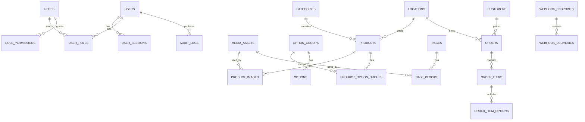

# Dilshad v1 — Cycle 1 Backend Architecture

## 1) Goals (Cycle 1)
- Power a restaurant ordering platform with reliable catalog + checkout + order management.
- Support both customer-facing app and admin CMS from one backend.
- Enforce role-based access for operations staff.
- Keep architecture simple enough for fast delivery, with clear extension points.

## 2) Proposed Technical Architecture

## Runtime
- **API**: Node.js + TypeScript (NestJS or Fastify modular structure)
- **DB**: PostgreSQL
- **Cache/Queue**: Redis (BullMQ)
- **Storage**: S3-compatible object storage for media
- **Auth**: JWT access + refresh tokens; password login for admin users
- **Observability**: structured logs, error tracking, metrics

## Logical modules
1. **Identity & Access** (users, roles, sessions, permissions)
2. **Catalog** (categories, products, option groups/options, pricing)
3. **Content** (pages, banners, announcements, metadata)
4. **Orders** (cart validation, order lifecycle, status transitions)
5. **Locations** (restaurant branches, opening hours, serviceability)
6. **Media** (upload, image metadata, attachment mapping)
7. **Admin Ops** (audit log, settings, webhooks)

## Integration style
- REST API for Cycle 1.
- Webhooks for outbound notifications/events.
- Background workers for async jobs (image processing, email/SMS, webhook retries).

## 3) ERD (Cycle 1)

## Core tables (minimum)
- `users` (id, email, password_hash, status, last_login_at, created_at)
- `roles` (id, key, name)
- `permissions` (id, key, description)
- `user_roles` (user_id, role_id)
- `role_permissions` (role_id, permission_id)
- `user_sessions` (id, user_id, refresh_token_hash, expires_at, ip, user_agent)

- `customers` (id, phone/email optional, name, marketing_opt_in)
- `locations` (id, name, address, lat, lng, timezone, service_modes, is_active)
- `location_hours` (location_id, day_of_week, open_time, close_time, is_closed)

- `categories` (id, slug, name, description, sort_order, is_active)
- `products` (id, location_id nullable/global, category_id, slug, name, description, base_price, currency, is_active, is_available)
- `option_groups` (id, name, min_select, max_select, is_required)
- `options` (id, option_group_id, name, price_delta, is_active)
- `product_option_groups` (product_id, option_group_id, sort_order)

- `media_assets` (id, bucket, object_key, mime_type, width, height, alt_text, created_by)
- `product_images` (product_id, media_asset_id, sort_order, is_primary)

- `orders` (id, order_no, customer_id, location_id, type, status, payment_status, subtotal, tax_total, discount_total, total, currency, placed_at)
- `order_items` (id, order_id, product_id_snapshot, product_name_snapshot, unit_price, qty, line_total, notes)
- `order_item_options` (order_item_id, option_name_snapshot, price_delta_snapshot)
- `order_status_history` (id, order_id, from_status, to_status, changed_by_user_id nullable, changed_at, reason)

- `pages` (id, slug, title, status, seo_title, seo_description)
- `page_blocks` (id, page_id, type, content_json, sort_order)

- `settings` (key, value_json, updated_by, updated_at)
- `audit_logs` (id, actor_user_id, entity_type, entity_id, action, diff_json, created_at)
- `webhook_endpoints` (id, url, secret, is_active, events_json)
- `webhook_deliveries` (id, endpoint_id, event_type, payload_json, status, attempts, next_retry_at)

## 4) API Surface (Cycle 1)

## Public/Customer API (`/v1`)
### Catalog
- `GET /locations` — active locations
- `GET /locations/:id/menu` — categories + products + options for location
- `GET /products/:slug` — product detail

### Cart/Order
- `POST /orders/quote` — validate cart, calculate totals
- `POST /orders` — place order
- `GET /orders/:orderNo` — track order status

### Content
- `GET /pages/:slug` — CMS page content
- `GET /banners` — active promotional banners

## Admin API (`/v1/admin`)
### Auth & Users
- `POST /auth/login`
- `POST /auth/refresh`
- `POST /auth/logout`
- `GET /users`
- `POST /users`
- `PATCH /users/:id`
- `POST /users/:id/roles`

### Catalog Management
- `GET/POST/PATCH /categories`
- `GET/POST/PATCH /products`
- `GET/POST/PATCH /option-groups`
- `GET/POST/PATCH /options`
- `POST /products/:id/images`
- `DELETE /products/:id/images/:imageId`

### Orders Operations
- `GET /orders` (filters: status, location, date range)
- `GET /orders/:id`
- `POST /orders/:id/status` (state transition with reason)
- `POST /orders/:id/cancel`

### Content/CMS
- `GET/POST/PATCH /pages`
- `GET/POST/PATCH /banners`
- `POST /media/upload-url` (presigned upload)

### Platform Ops
- `GET/PATCH /settings`
- `GET /audit-logs`
- `GET/POST/PATCH /webhooks`
- `POST /webhooks/:id/test`

## Events (internal/outbound)
- `order.created`
- `order.status.changed`
- `product.updated`
- `page.published`

## 5) Auth, Roles, Permissions

## Auth
- Admin users authenticate with email/password.
- Access token (short TTL) + refresh token (longer TTL, revocable).
- Session stored in `user_sessions` with device/IP metadata.

## Baseline roles
- **Super Admin**: full system access, role management.
- **Manager**: catalog/content/orders/settings, no role escalation.
- **Staff (Ops)**: view orders, update statuses, limited catalog edits.
- **Content Editor**: pages/banners/media only.
- **Support/Viewer**: read-only dashboards + orders.

## Permission examples
- `catalog.read`, `catalog.write`
- `orders.read`, `orders.update_status`, `orders.cancel`
- `content.read`, `content.write`, `content.publish`
- `users.read`, `users.write`, `roles.assign`
- `settings.read`, `settings.write`
- `audit.read`, `webhooks.manage`

Enforcement: route-level guard + fine-grained service checks.

## 6) Order Lifecycle (Cycle 1)

States:
1. `draft` (quote only, optional internal)
2. `placed` (customer submitted)
3. `confirmed` (accepted by store)
4. `preparing`
5. `ready` (pickup) / `out_for_delivery` (if enabled)
6. `completed`
7. terminal: `cancelled` or `rejected`

Rules:
- All transitions recorded in `order_status_history`.
- Invalid transitions blocked (e.g., completed -> preparing).
- Cancellation reason mandatory for `cancelled/rejected`.
- Payment status tracked separately (`unpaid`, `paid`, `refunded`, `failed`).

## 7) Error Handling, Auditing, Webhooks, Queueing
- Standard API error envelope (`code`, `message`, `details`, `requestId`).
- Idempotency key support for `POST /orders`.
- Audit on all admin mutations with before/after diff.
- Webhook delivery retries with exponential backoff + dead-letter state.
- Queue jobs:
  - image processing
  - notification dispatch
  - webhook delivery
  - cleanup tasks

## 8) Implementation Plan (Cycle 1)

## Phase A — Foundation (Week 1)
- Project scaffold, env config, DB migrations, module boundaries.
- Auth + RBAC skeleton.
- Core shared utilities (validation, error format, logging).

## Phase B — Catalog + CMS primitives (Week 2)
- Categories/products/options/media models + admin CRUD APIs.
- Page + banner models and APIs.
- Audit logging for write endpoints.

## Phase C — Ordering (Week 3)
- Quote endpoint with price/tax calculation.
- Place order + status workflow + admin operations endpoints.
- Idempotency + status history.

## Phase D — Operational hardening (Week 4)
- Webhooks + retry workers.
- Rate limits, pagination, filtering, indexing pass.
- Integration tests for critical flows.

## Definition of Done (Cycle 1)
- End-to-end flow works: manage menu in CMS -> customer places order -> staff updates status -> customer tracks order.
- RBAC verified for all admin routes.
- Audit + webhook + queue flows functional.
- API docs published (OpenAPI) and smoke-tested.
